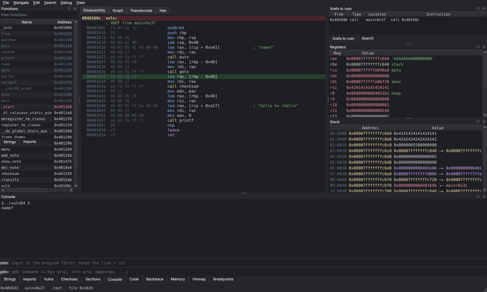
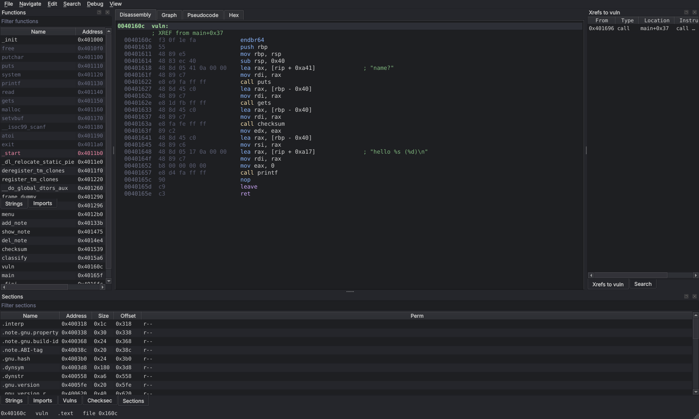
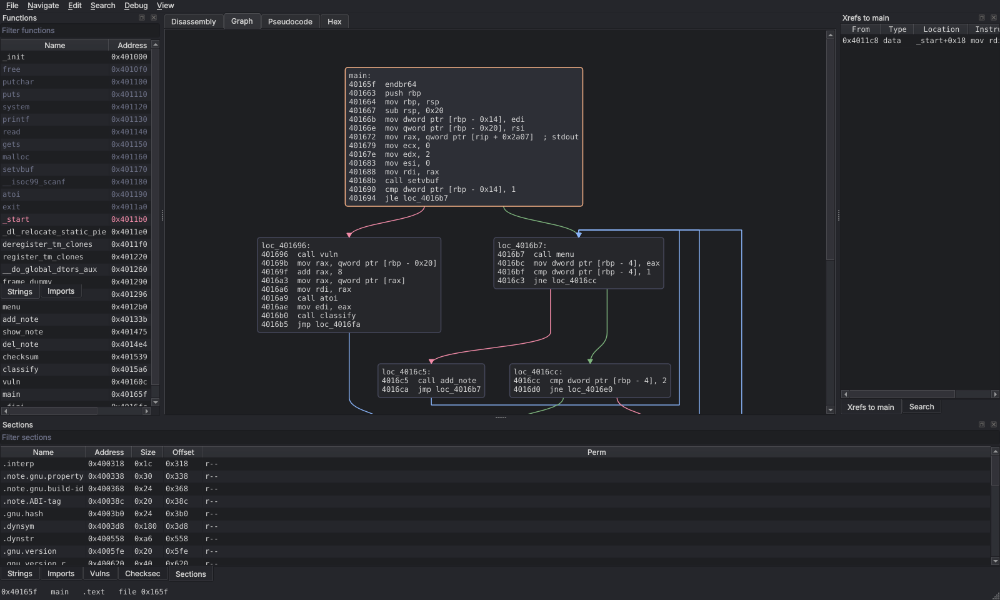
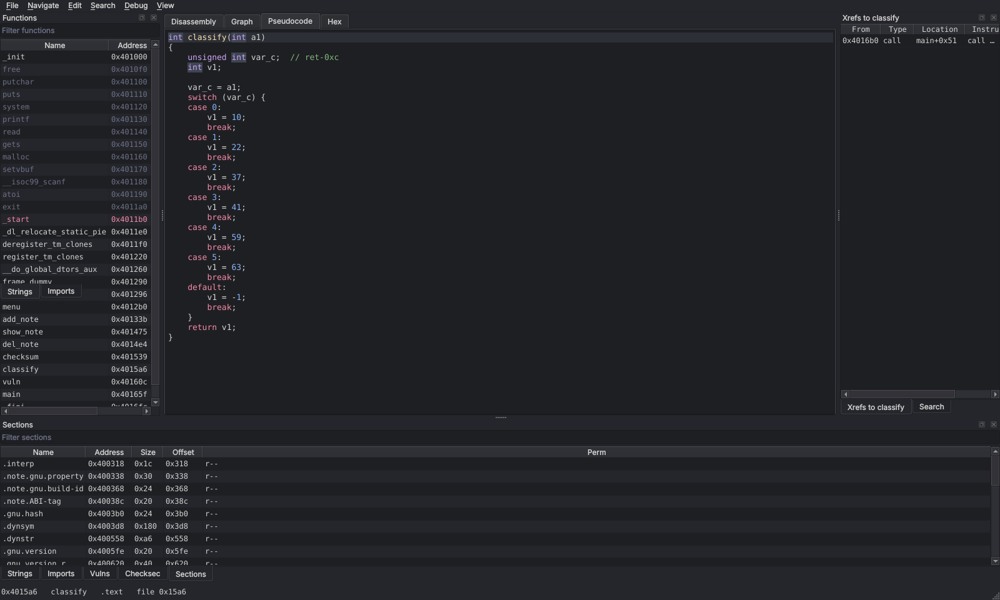
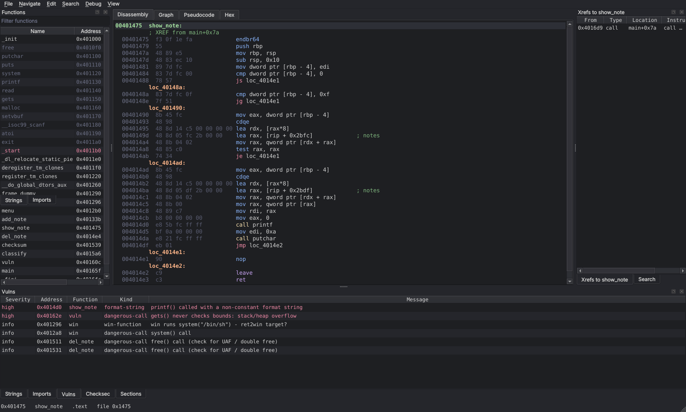
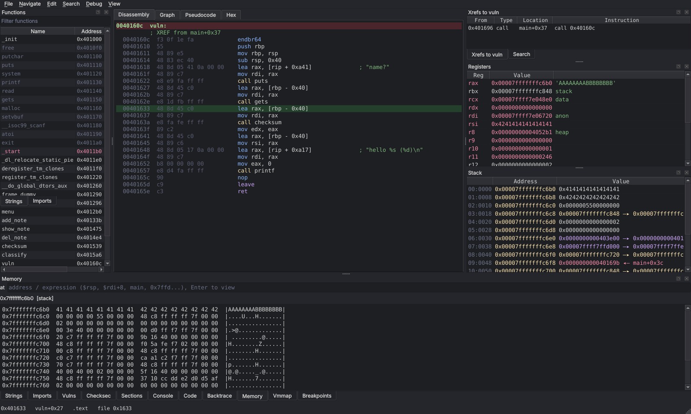
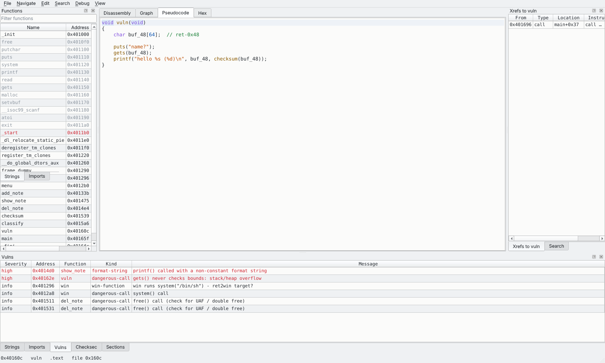

# Relic

리버싱과 포너블을 위한 디스어셈블러 / 디컴파일러 (WIP).

**목표: IDA Pro(+ Hex-Rays) 이상.** 아래 표는 IDA Pro를 기준선으로 한 현재 스펙과 진행률입니다.
진행 상황 세부는 [TODO.md](TODO.md), 디컴파일러 설계는 [docs/decompiler-plan.md](docs/decompiler-plan.md)를 참고하세요.



## 스크린샷

모두 테스트 샘플 [`tests/src/vuln.c`](tests/src/vuln.c)(`-O0 -no-pie -fno-stack-protector`)를 연 화면입니다.

| | |
|---|---|
|  |  |
| **리스팅** — 주소·바이트·명령어, 문자열 참조는 주석으로(`; "name?"`), 호출 대상은 이름으로. 왼쪽 함수 목록(import는 흐리게), 오른쪽 xref 패널 | **CFG 그래프** — 층별 배치, 조건 분기의 분기함/안 함 간선은 초록/빨강, 무조건 이동은 파랑. 루프로 돌아가는 간선은 블록 옆을 돌아 위로 올라감 |
|  |  |
| **의사 코드** — 점프 테이블을 `switch`로 복원한 `classify()`. 변수 이름 변경(`N`)은 바로 반영 | **Vulns** — 비상수 포맷 스트링(`printf(notes[i]->data)`), `gets()`, ret2win 후보(`win`), `free()` 호출 위치 |
|  |  |
| **디버거 Memory / Stack** — `$rbp-0x40`(=`buf`)의 hexdump와 스택 telescope. 반환 주소 `main+0x3c`까지 거리를 바로 셀 수 있음 | **라이트 테마** (`Ctrl+Shift+L`), 코드 글꼴 크기 `Ctrl+=`/`Ctrl+-` |

## 목표 대비 진행률 (기준: IDA Pro 9 + Hex-Rays)

진행률은 "IDA Pro가 그 영역에서 하는 일 중 Relic이 같은 수준으로 하는 비율"을 어림한 값입니다.
전체 값은 영역 가중 평균(가중치는 리버싱 실무에서의 비중)입니다.

**전체: 약 45%** — 분석·디컴파일 핵심 경로는 x86/ARM/MIPS/RISC-V 계열에서 실사용 가능, 파일 포맷(Mach-O)·타입 시스템(타입 자동 전파·라이브러리 타입)·디컴파일 품질(goto, SIMD)이 큰 격차.

| 영역 (가중치) | IDA Pro 기준 | Relic 현재 | 진행률 |
|---|---|---|---|
| 파일 포맷 (8) | ELF, PE, Mach-O, COFF/OMF, 펌웨어·raw 등 수십 종 | ELF, PE(import/export/COFF 심볼/.pdata), RAW | 35% |
| 프로세서 (8) | 60여 개 CPU 계열 | 디스어셈블 7종(x86, x64, ARM/Thumb, AArch64, MIPS, RISC-V, PPC), 분석·리프팅·디컴파일은 x86/x64/ARM/AArch64/MIPS32/RV64 | 46% |
| 자동 분석 (14) | 함수·CFG·xref·점프 테이블·noreturn·문자열·stripped 복구 | 재귀 하강 + 프롤로그 스캔, 점프 테이블(x86/ARM/AArch64/MIPS/RISC-V), 레지스터 상수 전파로 데이터 xref, stripped `main` 복구, ARM/Thumb 상호 운용 | 55% |
| 라이브러리 식별 (8) | FLIRT 시그니처, Lumina | FLIRT 방식 시그니처(`relic sigs build`로 정적 라이브러리에서 생성, stripped 정적 바이너리의 libc 함수 이름 — x86-64·ARM/Thumb·AArch64·MIPS·RISC-V, 재배치는 명령의 즉치 비트만 가림, RISC-V는 링커 완화 전까지만), 심볼·import·PLT 이름 | 38% |
| 타입 시스템 (10) | 구조체·열거형·로컬 타입, 타입 라이브러리, 타입 전파 | int/포인터/unsigned 추론, libc 시그니처 일부, 구조체 자동 복원(필드 오프셋·폭·포인터 타입, 중첩·자기 참조, 전역을 통해 함수 간 공유, 이름 변경), 배열 필드(`l->vals[i]`), 호출을 통한 구조체 공유(전역·지역), 변수·필드·반환 타입 직접 지정(`Y`, 구조체를 다른 함수에 적용), 구조체 편집 창, C 헤더 가져오기(구조체·공용체·비트필드·열거형·typedef·`#define` 상수·함수 원형, 대상 ABI 레이아웃; 열거형 상수 이름·플래그 조합 `A | B`, 비트필드 읽기·쓰기 `p->flags`, `p->flags = x;`로 출력), 라이브러리 함수 원형 약 180개 내장(인자 수·타입·결과) | 55% |
| 디컴파일러 (20) | Hex-Rays: 다수 아키텍처, 타입·구조체 대화형 수정, 부동소수점 | x86-64/x86-32/AArch64/ARM32/MIPS32/RV64GC, 재컴파일 검증, 구조화(switch·for·&&), 상수 나눗셈, -fipa-ra 레지스터 보존, 구조체 복원·대화형 재타입(`Y`), x86-64 SSE·AArch64·ARM VFP(armhf)·RISC-V F/D 부동소수점(`float`/`double` 인자·반환값·리터럴·변환·비교·`fma`, 레지스터보다 많은 인자, 비트 단위 재컴파일 검증); x87 부동소수점, SIMD 없음 | 52% |
| 대화형 UI (12) | 리스팅·그래프·xref·이름/주석·검색·패치·undo·북마크·구조체 창 | 리스팅·그래프(층별 레이아웃)·의사 코드·헥스, 이름/주석/변수 이름, xref, 이동 기록, 테마·확대, 검색(바이트·텍스트·즉치값·명령어), 바이트 패치(NOP·분기 반전·어셈블, 프로젝트에 저장, 패치된 파일 내보내기), 모든 편집(이름·주석·타입·구조체·북마크·패치)의 undo/redo, 북마크, 함수 안 데이터(리터럴 풀·인라인 점프 테이블·패딩) 표시 | 62% |
| 스크립팅·확장 (8) | IDAPython, IDC, SDK, 플러그인 | Python 라이브러리 API, 스크립팅 API(`here()`·`rename()`·`decompile()`·`patch()` …), GUI Python 콘솔, 플러그인(`register(api)` → Plugins 메뉴, 리스팅 줄 꾸미기·분석 완료·커서 이동 훅), `relic script` 배치 실행, CLI | 40% |
| 디버거 (7) | 로컬·원격(gdbserver 등) 디버깅 | 로컬 GUI 디버거(GDB/MI): 실행·단계 실행·중단점(조건·활성화·적중 횟수, 라이브러리 함수 이름)·하드웨어 watchpoint·리스팅/의사 코드 동기화, pwndbg식 레지스터·스택 telescope·vmmap·메모리 hexdump·백트레이스·콘솔, 레지스터·메모리 편집, PIE 슬라이드 보정; 원격·힙 뷰 없음 | 40% |
| 프로젝트·협업 (5) | IDB, 스냅숏, Teams, Lumina | `<binary>.relic.json`(이름·주석·변수 이름·타입·구조체·패치·북마크, 바이너리 SHA-256), 이름 붙인 스냅숏(복원은 undo 한 단계), 다른 분석가의 프로젝트 파일 병합(충돌 보고, 우리/그쪽 우선) | 35% |

IDA Pro에 없는 Relic 쪽 기능: checksec(ELF/PE 보호 기법), 포너블 휴리스틱(위험 함수, 비상수 포맷 스트링, 폭 없는 `scanf("%s")`, ret2win 후보), 디컴파일 결과의 재컴파일 검증 하네스.

### 다음 단계 (격차가 큰 순)

1. ~~검색(텍스트·바이트 패턴·즉치값·명령어)~~, ~~바이트 패치·패치된 바이너리 저장~~ (완료)
2. ~~GUI 안의 Python 콘솔과 플러그인 진입점 (IDAPython 대응)~~ (완료: `relic.scripting`)
3. ~~정적 링크 라이브러리 함수 식별 (FLIRT 대응 시그니처)~~ (완료: x86/x64; 다른 아키텍처 남음)
4. 구조체·타입 시스템과 디컴파일러 연동 (~~자동 복원·필드 접근·중첩·배열·이름 변경·타입 지정·편집 창, 열거형·공용체·C 헤더 가져오기~~ 완료)
5. Mach-O 로더, PPC 리프터 (MIPS32·RISC-V RV64는 완료)
6. ~~디버거 보강: watchpoint, 레지스터·메모리 값 편집~~ (완료)

## 기능

| 영역 | 상태 |
|---|---|
| 로더 | ELF / PE(import, export, COFF 심볼) / RAW(셸코드·펌웨어 blob) |
| 디스어셈블 | capstone 기반: x86, x64, ARM, AArch64, MIPS, RISC-V, PPC |
| 함수 탐색 / CFG | 재귀 하강, noreturn 처리, tail call, 점프 테이블 복원, MIPS 지연 슬롯, RISC-V pc 상대 분기·PLT |
| stripped 바이너리 | `__libc_start_main` 인자로 `main` 복구, 프롤로그 스캔, `.init_array` 시드, 정적 링크된 라이브러리 함수 이름(시그니처: `relic sigs build libc.a`) |
| 참조 | 코드/데이터 xref, 문자열(ASCII, PE는 UTF-16LE) |
| C++ | Itanium 심볼 디맹글링 (`geo::Rect::area() const`), 짧은 이름으로 이동·디컴파일 (`relic decompile ./a.out geo::total`) |
| checksec | ELF: RELRO / Canary / NX / PIE / FORTIFY / RPATH, PE: ASLR / DEP / CFG / SEH / GS |
| 포너블 휴리스틱 | `gets`·`strcpy` 등 위험 함수, 비상수 포맷 스트링, 폭 없는 `scanf("%s")`, ret2win 후보 |
| 프로젝트 | 이름 변경·주석·디컴파일러 변수 이름·바이트 패치를 `<binary>.relic.json`에 저장 (CLI 출력에도 반영, 패치는 열 때 다시 적용); 스냅숏(File ▸ Snapshots), 다른 프로젝트 파일 병합(File ▸ Merge project) |
| 패치 | 바이트·NOP·조건 분기 반전(x86, ARM/Thumb, AArch64, MIPS)·어셈블(keystone), 패치 후 재분석, 패치된 파일 내보내기(`relic patch`, Edit 메뉴) |
| GUI | 함수 목록, 디스어셈블리 / CFG 그래프 / 의사 코드 / 헥스, xref·문자열·import·vulns·checksec 패널 |
| 디컴파일러 (x86-64, x86-32, AArch64, ARM32, MIPS32, RISC-V RV64GC) | 리프팅 → SSA·최적화 → 호출 인자·스택 버퍼·카나리 → out-of-SSA → 구조화 → C 출력(`relic decompile`) |

> 인자 추적 기반 탐지(포맷 스트링, ret2win)와 점프 테이블 복원은 **x86-64·x86-32·AArch64·ARM32·MIPS32·RV64**에서 동작합니다.

## 설치

```sh
python3 -m venv .venv
.venv/bin/pip install -e '.[dev]'
```

Python 3.10 이상, 의존성: capstone, pyelftools, pefile, PySide6. 디버거를 쓰려면 `gdb`(또는 `gdb-multiarch`)가 PATH에 있어야 합니다(`sudo apt install gdb`).

## 사용법

```sh
relic info      ./chall              # 헤더, 섹션, 라이브러리
relic checksec  ./chall              # 보호 기법
relic funcs     ./chall [-a]         # 함수 목록 (-a: import 스텁 포함)
relic disasm    ./chall [main]       # 함수/주소 디스어셈블 (기본: main 또는 entry)
relic disasm    ./chall 0x401000 -n 20   # 선형 스윕
relic cfg       ./chall classify | dot -Tsvg > cfg.svg
relic strings   ./chall
relic imports   ./chall
relic xrefs     ./chall menu
relic strings   ./chall -g bin/sh    # 부분 문자열 검색
relic vulns     ./chall              # 포너블 휴리스틱
relic ir        ./chall vuln         # 디컴파일러 IR (리프팅 직후, 디버깅용)
relic opt       ./chall checksum --xrefs  # SSA + 최적화 IR, 문자열·교차참조, 스택 프레임
relic decompile ./chall main         # C 유사 의사 코드 (--addrs: 줄마다 명령어 주소, -a: 모든 함수)
relic decompile ./chall main --header chall.h   # C 선언(구조체·열거형·typedef·원형)을 써서 디컴파일
relic types     ./chall chall.h      # C 헤더를 프로젝트에 가져오기 (인자 없이: 가져온 타입 목록)
relic decompile ./chall -a -o chall.c   # 바이너리 전체 의사 코드를 C 파일 하나로 (구조체 선언은 한 번)
relic project   ./chall snapshot before  # 지금의 이름·주석·타입을 스냅숏으로 (snapshots / restore / delete)
relic project   ./chall merge bob/chall.relic.json   # 다른 분석가의 작업 병합 (--theirs: 충돌 시 그쪽 값)
relic search    ./chall --bytes '48 8b ?? 05'   # 바이트 패턴 (--text, --imm 0x186a0, --insn 'call.*system')
relic script    ./chall rename_all.py arg1      # 스크립팅 API로 Python 실행 (--save: 프로젝트 저장, 옵션은 스크립트 앞에)
relic sigs build /usr/lib/x86_64-linux-gnu/libc.a -o ~/.relic/sigs/glibc-x64.sig   # 라이브러리 시그니처
relic funcs     ./static_stripped               # 시그니처로 이름 붙인 함수는 [lib] (--sigs F.sig, --no-sigs)
relic patch     ./chall main+0x2f --invert      # 조건 분기 반전 → ./chall.patched (--nop, --bytes '90 90',
                                                #   --asm 'xor eax, eax; ret', --revert, --list, -o 출력 파일)
relic disasm    sc.bin --arch x64 --base 0x1000 -n 30   # RAW blob
```

주소 인자는 `0x401000`, `401000`, `main`, `main+0x10` 형식을 받습니다.

예시 (`tests/src/vuln.c`, `-no-pie -fno-stack-protector`):

```
$ relic vulns vuln64.out
[high  ] 0x4014d0 show_note            format-string   printf() called with a non-constant format string
[high  ] 0x40162e vuln                 dangerous-call  gets() never checks bounds: stack/heap overflow
[info  ] 0x401296 win                  win-function    win runs system("/bin/sh") - ret2win target?
```

디컴파일 예시 (`-fstack-protector-strong -pie -O1`):

```
$ relic decompile vuln64_pie.out vuln
void vuln(void)
{
    char buf_58[72];  // ret-0x58
    // stack canary at ret-0x10 (check hidden)

    puts("name?");
    gets(buf_58);
    __printf_chk(1, "hello %s (%d)\n", buf_58, checksum(buf_58));
}
```

지역 변수 이름은 진입 시 스택 포인터(반환 주소 위치) 기준 오프셋입니다. `buf_58`은 반환 주소에서 0x58 아래에 있고, 크기 72는 다음 슬롯(카나리)까지의 거리입니다 — 오버플로 페이로드 계산에 그대로 쓸 수 있습니다.

구조체는 고정 오프셋 접근에서 자동으로 복원됩니다. 전역 배열 `notes`의 원소가 가리키는 구조체는 그 배열을 쓰는 모든 함수에서 같은 정의를 씁니다:

```
$ relic decompile vuln64.out add_note
struct s_notes {  // recovered, 12 bytes
    char *f_0;
    int f_8;
};
...
        notes[var_1c] = malloc(16);
        notes[var_1c]->f_0 = malloc(var_20);
        notes[var_1c]->f_8 = var_20;
```

의사 코드에서 구조체·필드 이름에 `N`을 누르면 이름을 바꿀 수 있고(`struct note { char *data; int size; }`), `Y`로 변수나 필드에 타입을 줄 수 있습니다. 한 함수에서 복원된 구조체를 다른 함수의 매개변수에 `struct note *`로 적용하면 그 함수의 접근도 같은 구조체의 필드가 되고, 필드에 `struct item *`을 주면 그 필드를 거친 접근이 `->count`처럼 나옵니다. 모두 프로젝트 파일에 저장됩니다.

## GUI

```sh
relic ./chall                        # 또는 relic gui ./chall
relic sc.bin --arch x64 --base 0x1000
```

### 기본 흐름

1. **열기** — `relic ./chall` 또는 File → Open(`Ctrl+O`). 분석은 백그라운드에서 돌고 상태 표시줄에 진행률이 나옵니다(`Ctrl+.`로 취소). 끝나면 `main`(stripped면 복구한 `main`, 없으면 entry)으로 이동합니다.
2. **둘러보기** — 왼쪽 Functions에서 함수를 더블클릭(`Ctrl+F`로 이름 필터). 리스팅에서 `call`/`jmp` 대상이나 심볼을 더블클릭하면 따라가고 `Esc`로 돌아옵니다. `Space`는 그래프, `Tab`은 의사 코드(커서 위치를 서로 맞춰 줌), `Ctrl+H`는 헥스.
3. **참조 찾기** — `X`로 커서 위치를 가리키는 xref 목록. Strings 탭의 문자열을 더블클릭하면 그 문자열을 쓰는 코드로 갑니다.
4. **정리하기** — `N`으로 함수·라벨 이름(의사 코드에서는 지역 변수·매개변수 이름), `;`로 주석. `Ctrl+S`로 `<binary>.relic.json`에 저장되고 다시 열면 그대로 복원됩니다.
5. **찾기** — Search 메뉴: 바이트 패턴 `48 8b ?? 05`(`Alt+B`), 텍스트(`Alt+T`, UTF-8/UTF-16), 즉치값(`Alt+I`), 명령어 정규식 `call.*(gets|system)`(`Ctrl+Alt+I`). 결과는 Search 패널에서 더블클릭으로 이동.
6. **취약점 훑기** — 아래 Vulns 탭(위험 함수·포맷 스트링·ret2win 후보)과 Checksec 탭(NX·PIE·canary·RELRO).

### 단축키

| 키 | 동작 |
|---|---|
| `G` | 주소 / 심볼로 이동 |
| `Esc`, `Alt+←` / `Ctrl+Enter`, `Alt+→` | 뒤로 / 앞으로 |
| `Space` | 리스팅 ↔ 그래프 전환 |
| `-` / `L` / `+` | 그래프에서 선택 블록 접기 / 그 블록을 감싼 루프 접기 / 펼치기 (더블클릭으로도 펼침) |
| `Tab`, `F5` | 리스팅 ↔ 의사 코드 전환 (커서 위치 동기화) |
| `Ctrl+H` | 헥스 뷰 |
| `Ctrl+F` | 함수 필터 |
| `N` | 이름 변경 (함수·라벨, 커서 줄의 호출 대상; 의사 코드에서는 커서 아래 지역 변수·매개변수·구조체·필드) |
| `;` | 주석 |
| `Y` | 의사 코드에서 변수·매개변수·구조체 필드의 타입 지정 (`char *`, `unsigned int`, `struct note *`; 비우면 복원된 타입) |
| `X` | xref 패널 |
| `Ctrl+S` | 프로젝트 저장 (`<binary>.relic.json`) |
| `Alt+B` / `Alt+T` / `Alt+I` / `Ctrl+Alt+I` | 바이트 패턴(`48 8b ?? 05`) / 텍스트 / 즉치값 / 명령어 정규식 검색 (결과는 Search 패널) |
| `F9` / `Shift+F9` | 디버거 시작·계속 / `main`에서 멈추게 시작 |
| `F7` / `F8` / `Ctrl+F7` | 한 명령 단계 실행(들어감) / 건너뜀 / 함수 끝까지 |
| `F4` / `F2` | 커서까지 실행 / 중단점 토글 |
| `Ctrl+Alt+B` / `Ctrl+Alt+W` | 이름으로 중단점(`vuln`, `puts@plt`, libc의 `puts`) / watchpoint 추가 |
| `Ctrl+Alt+Pause` / `Ctrl+F2` | 일시 정지 / 종료 |
| `Ctrl+Alt+P` / `Ctrl+Alt+A` | 바이트 패치 / 어셈블해서 패치 (`pip install .[asm]`: keystone) |
| `Ctrl+Alt+N` / `Ctrl+Alt+J` | 명령어를 NOP으로 / 조건 분기 반전 (Edit ▸ Revert patch, Export patched file) |
| `Ctrl+Z` / `Ctrl+Shift+Z` | 마지막 편집 되돌리기 / 다시 하기 (이름·주석·타입·구조체·북마크·패치를 순서대로, 커서는 그 위치로) |
| `Alt+M` / `Ctrl+M` | 커서 위치 북마크(설명 입력, 비우면 삭제) / Bookmarks 패널 (더블클릭 이동, `Delete`로 삭제) |
| `Ctrl+Shift+S` | 구조체 창: 복원된 구조체의 필드 이름·타입 수정, 필드 추가(`0x10 char[8] tag`)·삭제 |
| `Ctrl+Shift+P` | Python 콘솔 (`an`, `here()`, `goto()`, `rename()`, `decompile()`, `patch()` …, ↑/↓ 기록) |
| `Ctrl+.` | 실행 중인 분석 / 취약점 스캔 / 검색 취소 |
| `Ctrl+Shift+L` | 라이트 / 다크 테마 전환 |
| `Ctrl+=` / `Ctrl+-` / `Ctrl+0` | 코드 글꼴 크게 / 작게 / 기본 (테마·크기는 저장됨) |

더블클릭으로 분기 대상·심볼(의사 코드에서는 함수·전역 이름, `loc_` 레이블)을 따라갑니다. 의사 코드는 탭을 열 때 함수 단위로 백그라운드에서 디컴파일하고(그동안 GUI는 멈추지 않음) 캐시하며, 이름 변경은 바로 반영됩니다. 문자열 테이블에서 더블클릭하면 그 문자열을 참조하는 코드로 이동합니다.

분석과 취약점 스캔은 백그라운드에서 돌며 상태 표시줄에 진행 상황과 Cancel 버튼이 나옵니다. 창을 닫으면 실행 중인 작업을 기다리지 않고 취소합니다. 스캔이 실패하면 Vulns 표에 빈 결과 대신 오류가 표시됩니다. CFG 그래프는 층별 배치(루프는 위로 돌아가는 간선, 긴 간선은 블록 사이로 우회, 교차 최소화)로 그립니다.

### 디버거 (로컬, pwndbg 스타일 GUI)

Debug 메뉴(`F9`)가 열린 바이너리를 로컬 `gdb`(GDB/MI)로 실행합니다. 모든 디버깅은 이 컴퓨터에서 돌며 원격 연결은 없습니다. 프로그램 인자는 Debug → Program arguments에서 지정하고, 표준 입출력은 Console 패널(pty)로 주고받습니다(아래 줄은 gdb 명령).

- **Registers**: 범용 레지스터, 바뀐 값 강조, 포인터는 pwndbg처럼 가리키는 곳(코드 심볼·문자열·스택/힙 체인)을 표시
- **Stack**: `telescope` — 스택 워드와 포인터 체인, 매핑 종류(code/stack/heap/data)별 색
- **Backtrace** / **Code**: 호출 스택(클릭하면 해당 위치로 이동), 현재 pc 주변 디스어셈블
- **Breakpoints**: 중단점·watchpoint 목록(체크로 활성/비활성, 조건 `$rdi == 5` 편집, 적중 횟수, `Delete`로 삭제), 실행을 다시 시작해도 유지
  - 이름으로 중단점: 바이너리 함수나 `puts@plt`는 그 주소에, `puts`처럼 import한 라이브러리 함수는 libc 안의 함수 본체에서 멈춤(라이브러리가 아직 로드되지 않았으면 로드될 때 설정)
  - watchpoint: 쓰기/읽기/접근, 대상은 바이너리 전역·주소(`notes`, `notes+8`, `0x404040`; PIE 슬라이드 보정, 크기 1/2/4/8바이트)나 gdb 식(`*(int *)($rbp-4)`). 커서 줄이 참조하는 전역이 기본값. 멈추면 이전 값 → 새 값을 Console과 상태 표시줄에 표시
- **Vmmap** / **Memory**: 프로세스 메모리 맵(종류별 색), 주소·식(`$rsp+8`, `main`, `0x7ffd...`)의 hexdump. 레지스터·스택 값이나 매핑을 더블클릭하면 분석한 바이너리의 코드는 리스팅으로, 그 밖은 Memory 뷰로 따라갑니다
- 패치가 있으면 디버거는 패치된 이미지(임시 사본)를 실행합니다 — 리스팅에 보이는 코드가 실제로 돕니다
- 리스팅과 의사 코드에서 현재 pc 줄(의사 코드는 그 명령이 속한 문장)은 초록, 중단점은 빨강으로 표시하며 멈출 때마다 정적 주소로 따라갑니다(PIE 슬라이드는 자동 보정)
- 값 바꾸기: Registers 패널에서 `E`(또는 우클릭 ▸ Set)로 레지스터를 숫자나 gdb 식(`$rsp+8`)으로, Debug ▸ Write memory로 메모리에 hex 바이트(`41 42 ff`)·문자열(`"AAAA\n"`)·워드(`0x401136`)를 씁니다

#### 따라 해 보기: `vuln()`의 스택 오버플로 오프셋 구하기

맨 위 스크린샷을 만드는 순서입니다(`tests/bins/vuln64.out`, 테스트를 한 번 돌리면 생깁니다).

1. `relic tests/bins/vuln64.out`으로 열고 Debug → Program arguments에 `5`를 넣습니다(인자가 있으면 `main`이 메뉴 대신 `vuln()`을 부름).
2. 함수 목록에서 `vuln`으로 가서 `F2` — 첫 줄이 빨갛게 바뀝니다(중단점은 실행 전에 걸어 둬도 됨).
3. `F9`로 시작(entry에서 멈춤), 한 번 더 `F9`로 `vuln`의 중단점까지 갑니다. 리스팅의 초록 줄이 현재 위치이고, Registers/Stack/Code/Backtrace가 채워집니다.
4. `call gets` 다음 줄(`lea rax, [rbp - 0x40]`)에 커서를 두고 `F4`(커서까지 실행). 프로그램이 입력을 기다리면 Console의 **stdin** 줄에 `AAAAAAAABBBBBBBB`를 입력하고 Enter.
5. 멈추면 Registers의 `rax`가 버퍼를 가리키며 `'AAAAAAAABBBBBBBB'`를 보여 주고, Stack 패널에서는 `0x4141414141414141` 다음 몇 줄 아래에 반환 주소 `main+0x3c`가 보입니다.
6. Memory 탭의 주소 칸에 `$rbp-0x40`을 입력하면 버퍼부터 hexdump가 나옵니다. 의사 코드의 `char buf_48[64]; // ret-0x48`과 같이, 버퍼 시작에서 반환 주소까지는 0x48바이트입니다.
7. 값 위를 더블클릭하면 따라갑니다: 코드 주소는 리스팅으로, 그 밖은 Memory로. `F8`/`F7`로 계속 단계 실행하거나 `Ctrl+F2`로 종료합니다.

Console의 **gdb>** 줄에는 일반 gdb 명령(`x/8gx $rsp`, `info proc mappings`, `p $rdi`)을 그대로 쓸 수 있습니다. 컨테이너 안에서는 gdb가 자식 프로세스를 추적할 수 있도록 ptrace 권한(`--cap-add=SYS_PTRACE`)이 필요할 수 있습니다.


## 스크립팅과 플러그인

GUI의 Python 콘솔(`Ctrl+Shift+P`), 플러그인, `relic script`는 같은 이름들을 씁니다(`relic/scripting.py`):
`an`, `bin`, `here()`, `goto(x)`, `addr(x)`, `name(a)`, `rename(a, n)`, `comment(a, t)`, `func(x)`, `functions()`,
`xrefs_to(a)`, `xrefs_from(a)`, `disasm(x, n)`, `decompile(x)`, `strings()`, `search('48 8b ?? 05')`,
`patch(a, b'..')`, `nop(a)`, `invert(a)`, `assemble(a, 'ret')`, `revert(a)`, `save()`.

```python
# ~/.relic/plugins/mark_gets.py  (또는 RELIC_PLUGINS 환경 변수의 디렉터리)
def register(api):
    def run(ns):
        for f in ns["functions"]():
            if "gets(" in ns["decompile"](f):
                ns["comment"](f.addr, "calls gets")
    api.add_action("Mark gets() callers", run, "Ctrl+Alt+G")     # Plugins 메뉴에 추가

    # 리스팅 줄 꾸미기: 주석 덧붙이기, 배경색
    def deco(an, line):
        if line.mnemonic == "call" and "gets" in line.operands:
            return {"comment": "unbounded read", "color": "#5a1e1e"}
    api.add_line_decorator(deco)

    api.on_analysis(lambda ns: print(len(ns["functions"]()), "functions"))   # 분석이 끝날 때마다 (패치 후 재분석 포함)
    api.on_cursor(lambda ns, a: None)                                        # 커서가 다른 주소로 갈 때
```

플러그인을 불러오다 난 오류나 훅 안의 예외는 GUI를 막지 않고 Python 콘솔에 (훅마다 한 번) 표시됩니다.

## 라이브러리로 사용

```python
from relic.analysis import analyze

an = analyze("./chall")
main = an.function_by_name("main")
for blk in main.blocks.values():
    print(hex(blk.addr), [hex(s) for s in blk.succs])
print(an.checksec())
for v in an.vulns():
    print(v.severity, hex(v.addr), v.message)
```

## 구조

```
relic/
  loader/      ELF / PE / RAW → 공통 Binary 모델 (섹션, 세그먼트, 심볼, import, 재배치)
  disasm.py    capstone 래퍼, 명령어 분류(call/jmp/cjmp/ret/halt), 분기 대상·데이터 참조 추출
  analysis/    함수 탐색·CFG(functions), 문자열, checksec, 취약점 휴리스틱, xref, 프로젝트 저장
  decompiler/  IR, 리프터(x86/x64, AArch64, ARM32, MIPS32, RV64), SSA·최적화, 호출/스택 복원, 구조화, C 출력 (docs/decompiler-plan.md)
  listing.py   심볼/문자열 주석이 붙은 디스어셈블리 리스팅 (CLI·GUI 공용)
  gui/         PySide6 메인 윈도우와 뷰 위젯, CFG 층별 레이아웃(layout.py)
  progress.py  백그라운드 작업 취소 토큰·진행 보고
  __main__.py  CLI
tests/
  src/vuln.c   테스트용 포너블 샘플 (테스트 실행 시 tests/bins/에 빌드)
```

## 테스트

```sh
.venv/bin/pytest -q
.venv/bin/ruff check .      # 린트 (pip install -e ".[dev]"에 포함)
```

gcc가 있으면 `tests/src/vuln.c`를 여러 변형(no-PIE, PIE+보호기법, strip)으로 빌드해 검증합니다. 디컴파일러는 IR 인터프리터로 각 변환 단계의 의미 보존을 확인하고, `checksum`·`classify`의 디컴파일 결과를 다시 컴파일해 원본 소스와 같은 결과를 내는지 비교합니다. 컴파일러가 없으면 해당 테스트는 skip됩니다. GUI 테스트는 `QT_QPA_PLATFORM=offscreen`으로 실행되며, Qt 시스템 라이브러리(libEGL 등)가 없으면 skip됩니다.

## 라이선스

MIT
