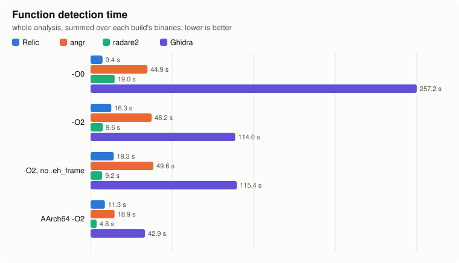
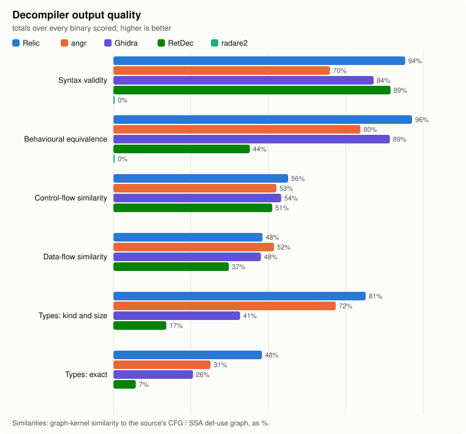

# Benchmarks against other open-source tools

How Relic compares with **Ghidra**, **angr**, **RetDec**, **radare2** and **LIEF** on
stripped Linux binaries: how many functions each finds and how many of those are real (function
detection), how well its file loader agrees with LIEF's, and how its decompiler's output
compares with Ghidra's, angr's, RetDec's and radare2's: whether it is C, whether it computes
what the program computes, how close its control flow, data flow and types are to the source.
Measured 2026-11-17/18 on a 4-core x86-64 Linux container. Each timing is a single run.

| Tool | Version | What it was compared on |
|---|---|---|
| Relic | 1.6.0 + this branch | everything |
| Ghidra | 12.2 | function detection (headless auto-analysis), decompiler |
| angr | 10.0.7 | function detection (`CFGFast`), decompiler |
| RetDec | 5.0 | decompiler |
| radare2 | 5.5.0 | function detection (`aaa`), its pseudocode (`pdc`) |
| LIEF | 1.0.0 | function list from `.eh_frame`, file parsing |

Every tool runs with its default options. The scripts are in `tools/`, so anyone can rerun
everything, and `tools/bench_charts.py` redraws the charts from their JSON output.

## Corpus

Built from source with gcc 13.3 (`-fno-stack-protector`), then `strip`ped. The unstripped copy
supplies the ground truth: its function symbols (`readelf -s`, so none of the compared tools)
inside `.text`. Every tool sees only the stripped copy.

| Program | Source |
|---|---|
| brotli | brotli 1.2.1, the `brotli` command line tool |
| lua | Lua 5.4 interpreter (`lua.c` and the library) |
| zstd | zstd 1.5.7 single-file library plus a small driver |
| vuln, flow | Relic's own test programs (`tests/src`) |

Each in four builds: `-O0`, `-O2`, `-O2` without `.eh_frame` (`-fno-asynchronous-unwind-tables`;
some toolchains and most hand-written or obfuscated code have no unwind tables), and `-O2` for
AArch64 (lua and zstd only). 17 binaries, 7,393 functions.

## Function detection

`python tools/compare_tools.py CORPUS --angr-python PY_WITH_ANGR_AND_LIEF --tools relic,angr,r2,lief,ghidra --ghidra GHIDRA_DIR --json out.json`

Recall: share of the true functions a tool finds. Precision: share of what it reports that is a
true function start. Only addresses in `.text` are scored (PLT stubs aren't functions of the
program). Totals over all binaries of a build; time is the whole analysis, summed.

| Build (functions) | Tool | Recall | Precision | F1 | Time |
|---|---|---:|---:|---:|---:|
| -O0 (2,877) | **Relic** | **1.000** | **1.000** | **1.000** | 12.0 s |
| | angr | 0.998 | 0.934 | 0.965 | 44.9 s |
| | Ghidra | 0.955 | 1.000 | 0.977 | 257.2 s |
| | radare2 | 0.820 | 1.000 | 0.901 | 19.0 s |
| | LIEF (eh_frame) | 0.997 | 1.000 | 0.998 | 1.7 s |
| -O2 (1,610) | **Relic** | 0.993 | 0.998 | **0.996** | 6.8 s |
| | angr | 0.991 | 0.932 | 0.960 | 48.2 s |
| | Ghidra | 0.620 | 0.996 | 0.764 | 114.0 s |
| | radare2 | 0.601 | 1.000 | 0.751 | 9.6 s |
| | LIEF (eh_frame) | 0.994 | 1.000 | 0.997 | 1.7 s |
| -O2, no .eh_frame (1,610) | **Relic** | **0.993** | **0.998** | **0.995** | 6.8 s |
| | angr | 0.961 | 0.819 | 0.885 | 49.6 s |
| | Ghidra | 0.653 | 0.984 | 0.785 | 115.4 s |
| | radare2 | 0.601 | 1.000 | 0.751 | 9.2 s |
| | LIEF (eh_frame) | 0.009 | 1.000 | 0.018 | 1.8 s |
| AArch64 -O2 (1,296) | **Relic** | **1.000** | **1.000** | **1.000** | 13.7 s |
| | angr | 0.999 | 0.807 | 0.893 | 18.9 s |
| | Ghidra | 0.665 | 0.816 | 0.733 | 42.9 s |
| | radare2 | 0.576 | 0.992 | 0.729 | 4.8 s |
| | LIEF (eh_frame) | 0.998 | 1.000 | 0.999 | 1.7 s |

- **Relic has the best F1 of the code analysers in every build** (0.995–1.000: exact at -O0 and
  on AArch64), and is 4–7× faster than angr (1.4× on AArch64) and 3–21× faster than Ghidra.
- **Ghidra** is close to perfect at -O0 but, with its default analysis, misses a third of the
  functions at -O2 (recall 0.62): functions reached only through pointers (`main`, handed to
  `__libc_start_main`, callbacks, function tables) or tail calls. It almost never reports a wrong
  one on x86-64; on AArch64 18% of what it reports isn't a function start. Its times include
  about 9 s of Java start-up per binary.
- **Without `.eh_frame`** Relic barely changes (F1 0.996 → 0.995), angr drops to 0.885 and
  LIEF to nearly nothing: LIEF's list *is* the unwind table, which is why it is close to
  perfect when that's there. It's a ceiling to compare with, not a code analyser.
- **radare2** reports nothing false but misses 18% of the functions at -O0 and 40% at -O2
  (functions only reached through pointers or tail calls).

What Relic still misses: the **`.cold` parts** gcc moves out of a function (`foo.cold`) have a
symbol of their own, so they count as functions in the ground truth, but Relic (rightly) treats
them as parts of their parent -- 11 of the 12 misses at -O2. And 2 false starts inside brotli's
decoder, 1 in Lua's.

This benchmark first measured F1 0.986 / 0.965 / 0.963 / 0.969 for Relic. Two bugs it showed are
fixed: the labels of `luaV_execute`'s computed `goto` table (`goto *disptab[op]`) were made
functions -- 84 of them, CET builds start each label with `endbr64` like a function -- and a
switch's bounds check with moves scheduled between the `cmp` and the `ja` was missed, so its
table was read to its 512-entry cap and one zstd function took in eleven others (that binary
took 13.6 s; now 3.4 s).

## File parsing (Relic's loader vs LIEF)

`python tools/compare_formats.py FILE... --lief-python PY --json out.json`

221 files: 150 programs from `/usr/bin`, 60 libraries from `/usr/lib/x86_64-linux-gnu` and
Relic's test binaries (ELF, PE, Mach-O, object files, several architectures).

| | Relic | LIEF |
|---|---:|---:|
| Files parsed | 221 / 221 | 221 / 221 |
| Same entry point | 219 | |
| Same sections (name and address) | 219 | |
| ELF imports, precision vs `readelf --dyn-syms` | 0.710 | 1.000 |
| ELF imports, recall | 0.958 | 0.969 |
| Total parsing time | 37.3 s | 1.1 s |

- The two section disagreements are Mach-O object files, where Relic also lists the sections it
  makes up for external symbols and the GOT (`__extern`, `__got`).
- **Imports.** The difference is mostly a matter of definition: Relic lists as imports the
  variables a program takes from a library through copy relocations (`stderr`, `stdout`),
  which `readelf` shows as defined in the program (that's the precision gap). It misses
  imported *data* symbols that nothing relocates through the PLT, such as C++ type-info
  vtables (`_ZTVN10__cxxabiv117__class_type_infoE`) and `__progname`. LIEF misses weak symbols
  (`__gmon_start__`, `_ITM_*`).
- **Speed.** LIEF is C++; Relic's loader is pure Python and does more on load (symbols,
  relocations, demangling): about 34× slower, 0.17 s per file on average.

## Decompiler (Relic vs Ghidra, angr, RetDec and radare2)

`python tools/compare_decompilers.py CORPUS NAME... --tools relic,angr,ghidra,retdec,r2 --angr-python PY --ghidra DIR --retdec PROGRAM --limit 300 --json out.json`

The true functions of each stripped binary (up to 300 per binary, 1,233 in all), given to every
tool by address: Ghidra and RetDec decompile them even where their own analysis didn't make a
function there. "Valid C": the pseudocode of one function, alone, passes `gcc -fsyntax-only`
after a prelude of the types the tool's own output uses (the `<stdint.h>` types for all of them,
Ghidra's `undefined8`, `byte`, `processEntry` ..., the headers RetDec's output includes); errors
about what the function uses without declaring it (globals, callees, struct types) are not
counted, only output that isn't C; a member missing from a struct the tool declared itself
counts against it. Time: per function, not counting the analysis before it
(Relic, Ghidra, angr); RetDec decompiles the whole list in one run, analysis included.

| Binary | Functions | Tool | Decompiled | Valid C | gotos | Lines | Time |
|---|---:|---|---:|---:|---:|---:|---:|
| brotli -O2 | 249 | Relic | 247 | **203** | 3,257 | 97,413 | 74 s |
| | | Ghidra | 249 | 172 | 5,593 | 84,783 | 48 s |
| | | angr | 246 | 121 | 1,893 | 77,078 | 431 s |
| | | RetDec | 249 | **203** | 5,234 | 109,315 | 139 s (all) |
| zstd -O2 | 300 | Relic | 297 | **284** | 3,500 | 120,541 | 99 s |
| | | Ghidra | 300 | 207 | 3,951 | 89,731 | 25 s |
| | | angr | 296 | 122 | 2,368 | 101,357 | 594 s |
| | | RetDec | 298 | 249 | 7,376 | 136,628 | 177 s (all) |
| lua -O2 | 300 | Relic | 294 | **293** | **43** | 15,530 | 28 s |
| | | Ghidra | 300 | 291 | 179 | 9,708 | 2.3 s |
| | | angr | 294 | 263 | 131 | 13,538 | 50 s |
| | | RetDec | 295 | 291 | 361 | 9,242 | 5.4 s (all) |
| lua AArch64 -O2 | 300 | Relic | 300 | **297** | **46** | 16,579 | 33 s |
| | | Ghidra | 300 | 285 | 176 | 9,806 | 1.5 s |
| | | angr | 299 | 273 | 131 | 15,336 | 45 s |
| | | RetDec | 288 | 275 | 410 | 9,945 | 4.1 s (all) |
| vuln, flow (-O0, -O2) | 84 | Relic | 84 | 83 | 3 | 1,354 | 1.3 s |
| | | Ghidra | 84 | **84** | 1 | 1,462 | 0.5 s |
| | | angr | 80 | 80 | 1 | 1,239 | 6.6 s |
| | | RetDec | 84 | 83 | 3 | 1,280 | 0.5 s (all) |

radare2 decompiled all of them, 0 valid C (below).

- **radare2's `pdc`** decompiled every function but prints annotated pseudo-assembly
  (`rsp -= 0x18`, `goto loc_0x1460`), never C: 0 valid. It isn't timed per function here (one run
  for all of them, analysis included).
- **Valid C, in short:** Relic has the most valid functions on every one of the four programs:
  95% on zstd (RetDec 83%, Ghidra 69%, angr 41%), 82% on brotli (level with RetDec), 98–99% on
  lua (Ghidra and RetDec 92–97%). What's left in brotli and zstd is mostly `goto`-heavy state
  machines where a value is used both as a pointer and as an integer.
- **Speed:** Ghidra's decompiler is the fastest per function (5–8 ms on lua, 84–192 ms on the
  big functions of zstd and brotli), Relic second (95–333 ms), angr 1.4–6× slower than Relic.
  Relic's lua time is mostly one function: `luaV_execute`, Lua's interpreter loop, ~700 blocks
  since its computed-goto labels are recognised as its own (13–18 s; it used to be a fragment).
  Counted with its analysis, Ghidra takes longer overall (Java start-up and its full
  auto-analysis: 20–55 s per binary, against 1–4 s for Relic's).
- **gotos:** Relic has the fewest on lua (43–46 against 131–410) and fewer than Ghidra and RetDec
  on brotli and zstd, but more than angr there (3,257 against 1,893 on brotli).
- **Relic before this benchmark:** it found several places where Relic printed something gcc
  rejects; they are fixed on this branch (the table above shows the fixed version). Valid
  functions:

  | | brotli | lua | zstd | lua AArch64 |
  |---|---:|---:|---:|---:|
  | Relic before | 114 | 249 | 122 | 264 |
  | Relic now | 203 | 293 | 284 | 297 |

  What was fixed: arithmetic on pointers that C doesn't allow (`p1 * 8`, `p1 & 7`,
  `p1 + p2`) now casts the pointers to `int64_t`; an offset added to a `char *` prints as a
  number, never as a string literal at that address; a call through a local variable that
  isn't typed as a function pointer gets a cast; a struct whose only field is an array no
  longer declares a flexible array member alone (`[0]`, gcc's extension), and an array of
  unknown length followed by other fields gets the length up to the next one; a struct pointer
  read from an integer array is cast before `->` (`((struct s_18 *)a1[3])->f_18`, which Lua's
  `lua_State` accesses are full of).
  The big -O2 functions (inlined state machines, unrolled hash loops) are where every
  structurer falls back to `goto`.
- **Lines:** Relic's output is the longest on lua (about 1.6× Ghidra's), mostly because it keeps
  a temporary for each value read more than once.

## Decompiler output quality

`python tools/compare_decompilers.py ... --save OUT` keeps each tool's pseudocode, then
`python tools/decomp_quality.py CONFIG.json OUT --corpus CORPUS --json q.json` scores it (CONFIG
names each binary's `-g` build and its sources; the script's docstring has the format).

Valid C only says gcc parses the output. Five more things are measured on the same pseudocode,
for six binaries: lua, zstd and brotli at -O2, lua for AArch64, and `tools/bench/equiv.c` at
-O0 and -O2.

- **Behavioural equivalence.** `tools/bench/equiv.c` is 42 self-contained functions (arithmetic,
  switches, arrays, strings, structs by pointer and by value, floating point, recursion; libc
  only). Each tool's pseudocode of one function, decompiled from the stripped build, is compiled
  again with the libc headers and linked into a harness that calls it and the original on 40
  inputs each, comparing the results and every byte of memory it was given. A function passes
  when all 40 agree; not compiling, not linking (a callee or global it names that isn't there),
  crashing or a wrong answer all fail.
- **Control-flow similarity.** gcc's CFG of the pseudocode (compiled again at -O0) against gcc's
  CFG of the original source function at -O0, as a Weisfeiler-Lehman graph-kernel similarity
  (1.0: the same shape three blocks deep everywhere).
- **Data-flow similarity.** The same on gcc's SSA def-use graphs, nodes labelled by operation
  (add, load, store, call, phi ...), so values computed the same way from the same inputs match.
  Also the number of variables against the source's.
- **Type recovery.** Each parameter and the return type against the DWARF of the same build
  (`-g` makes byte-identical code; the scripts check): *kind and size* (integer, float,
  pointer, struct, and the width), *exact* (also signedness, and what a pointer points to), and
  whether the number of parameters is right.

To compile pseudocode that uses globals, callees or types it doesn't declare, the scorer adds
`extern long NAME;` / `typedef long NAME;` until gcc accepts it, and defines the helper
pseudo-functions some tools print (Ghidra's `CONCAT44`, `SUB84`, `CARRY4` ...) for everyone.
The similarities are averaged over the functions every C-producing tool's output compiled
(so no tool is averaged over easier ones): 696 of them.

| | Relic | Ghidra | angr | RetDec | radare2 |
|---|---:|---:|---:|---:|---:|
| Syntax validity (1,247 functions) | **94.2%** | 84.0% | 69.9% | 89.5% | 0% |
| Behavioural equivalence (84: 42 at -O0, 42 at -O2) | **96.4%** (81) | 89.3% (75) | 79.8% (67) | 44.0% (37) | 0% |
| Control-flow similarity | **0.564** | 0.542 | 0.526 | 0.513 | – |
| Data-flow similarity | 0.482 | 0.476 | **0.519** | 0.373 | – |
| Types: kind and size (parameters and results) | **81.5%** | 40.9% | 71.8% | 17.1% | – |
| Types: exact | **48.0%** | 25.7% | 31.4% | 7.2% | – |
| Number of parameters right | **95.4%** | 81.4% | 88.7% | 59.4% | – |
| Return type right (kind and size) | **77.5%** | 56.1% | 67.6% | 15.4% | – |
| Variables per source variable (median) | 2–4.3 | 1–2 | 1–3.5 | 2.5–6.4 | – |

Per binary, behavioural equivalence: Relic 41 of 42 at -O0 and 40 at -O2, Ghidra 38 / 37, angr
35 / 32, RetDec 21 / 16. What fails, by tool:

- **Relic:** `powmod` (its 128-bit `%` is libgcc's `__umodti3`, which in a stripped binary only
  library signatures name -- these runs have none; with `relic sigs build --system` it passes)
  and at -O2 `bubble_sort` (gcc swaps two ints with SSE shuffles, which Relic lifts wrongly).
- **Ghidra:** the switch table read by address (`DAT_001030e0`), `powmod` (128-bit values as
  `undefined1 auVar1[16]` with `._8_8_` members, not C, and the libgcc call), floating-point
  constants read by address (`poly`), `atoi_simple` split off as a thunk, and `sat_add`'s
  overflow test.
- **angr:** signed division and remainder done on `unsigned long long` (`gcd`, `div_round`,
  `calc`), `sat_add`, `atoi_simple`, `rect_area`, `mean`, the switch table, libgcc and an SSE
  swap (`CONCAT`).
- **RetDec:** no SSE floating point at all (`__asm_addsd`), globals for switch tables, and many
  wrong answers in plain integer code (a byte read before a loop lost, a struct field dropped).

What the numbers say about Relic:

- It is the most often *right* (equivalence) and has the best types and parameter counts, and
  the CFG closest to the source on the big programs.
- Its **data flow** is still further from the source than angr's: it keeps two to four times as
  many variables as the source (a temporary for each value read more than once, separate stack
  slots), where Ghidra stays near one. This is the next thing to improve.

### What the benchmark fixed in Relic

Running this found real bugs in Relic's output, now fixed (with tests that compile and run the
pseudocode, `tests/test_equiv.py`, and check parameters, `tests/test_params.py`):

- `cqo; idiv` (signed 64-bit `/` and `%`) printed as a 128-bit division of an unsigned dividend,
  wrong for negative values; now `a / b`.
- Constants with the top bit set in signed comparisons printed as unsigned (`0xffffffff80000000`),
  which turned the comparison unsigned; now `-0x80000000LL`. Unsigned operands of signed
  operations are cast.
- `int *` arithmetic added bytes as elements (`p + i + 8` for 8 bytes: an overrun), and a struct
  pointer moved by its size printed `p += 8` (8 structs).
- Rotates and add/subtract overflow flags printed as `__rol()` / `__sborrow()`; now plain C.
- A struct field overlapping an earlier one was used by name but not declared (94 zstd
  functions didn't compile).
- A parameter after an unused one was lost (`lua_typename(L, t)` had none, reading `rsi`), and
  registers moved into an internal callee's arguments didn't count; variadic functions took all
  six integer and eight xmm registers (`luaL_error` had 14 parameters) and their callers took
  on the registers they only left in place for them. Now the fixed parameters and `...`, and
  calls to them pass what was set: Lua parameter counts were right for 62% of the functions,
  now 97%.
- A parameter only passed on stayed an integer (`lua_pushstring(L, s)`: `int64_t a2`); it now
  gets the type the callee gives it (`char *` when it reaches `strlen`). Lua types, kind and
  size: 63% → 81% (angr 76%).
- gcc's lookup table for a switch (`CSWTCH`) was read by address; it is now declared with its
  contents (`static const int tbl_30e0[7] = { 2, 1, 1, 1, 1, 3, 2 };`). libgcc's
  `__umodti3` & co., when named, are the `%` they implement.

## Caveats

- One run per measurement, in a shared container: treat timings as ±20%.
- angr runs with its defaults (`CFGFast()`, normalized for the decompiler); radare2 with `aaa`;
  Ghidra with its default auto-analysis (`analyzeHeadless -import`). More aggressive options
  (`aaaa`, angr's `force_complete_scan`, Ghidra's Aggressive Instruction Finder) trade time and
  precision for recall.
- Ghidra 12.2 came from the SourceForge mirror of its GitHub releases and RetDec 5.0 from the
  `remnux/retdec` Docker image (its official release archive), as GitHub downloads weren't
  reachable here.
- gzip, grep and SQLite were meant to be in the corpus but their builds (`./configure`) weren't
  run in this environment.
- Valid C says nothing about whether the pseudocode means the same as the binary; behavioural
  equivalence does, but only on the 42 functions of `tools/bench/equiv.c`, x86-64.
- Graph similarities compare structure, not meaning, and are capped by what the compiler did:
  at -O2 inlining and loop transformations make no tool's output look like the source (0.4–0.65).
- Registers a tool leaves in its output (`rsi`, Ghidra's `in_RSI`) count as undeclared names:
  syntax validity doesn't catch them, parameter counts do.
