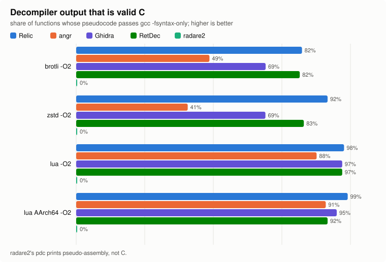

# Benchmarks against other open-source tools

How Relic compares with **angr**, **radare2** and **LIEF** on stripped Linux binaries: how
many functions each finds and how many of those are real (function detection), how well its
file loader agrees with LIEF's, and how its decompiler compares with angr's. Measured
2026-11-17 on a 4-core x86-64 Linux container. Each timing is a single run.

| Tool | Version | What it was compared on |
|---|---|---|
| Relic | 1.5.0 + this branch | everything |
| angr | 10.0.7 | function detection (`CFGFast`), decompiler |
| radare2 | 5.5.0 | function detection (`aaa`), its pseudocode (`pdc`) |
| LIEF | 1.0.0 | function list from `.eh_frame`, file parsing |

Ghidra (12.2) and RetDec (5.0) have workers in `tools/compare_decompilers.py`
(`--tools ghidra --ghidra DIR`, `--tools retdec --retdec PROGRAM`) but aren't in these numbers
yet: they were downloaded, but this environment's permission policy didn't allow running
programs from outside its package manager. The scripts are in `tools/`, so anyone can rerun
everything, and `tools/bench_charts.py` redraws the charts from their JSON output.

## Corpus

Built from source with gcc 13.3 (`-fno-stack-protector`), then `strip`ped. The unstripped copy
supplies the ground truth: its function symbols (`readelf -s`, so none of the compared tools)
inside `.text`. Every tool sees only the stripped copy.

| Program | Source |
|---|---|
| brotli | brotli 1.2.1, the `brotli` command line tool |
| lua | Lua 5.4 interpreter (`lua.c` and the library) |
| zstd | zstd 1.5.7 single-file library plus a small driver |
| vuln, flow | Relic's own test programs (`tests/src`) |

Each in four builds: `-O0`, `-O2`, `-O2` without `.eh_frame` (`-fno-asynchronous-unwind-tables`;
some toolchains and most hand-written or obfuscated code have no unwind tables), and `-O2` for
AArch64 (lua and zstd only). 17 binaries, 7,393 functions.

## Function detection

`python tools/compare_tools.py CORPUS --angr-python PY_WITH_ANGR_AND_LIEF --json out.json`

Recall: share of the true functions a tool finds. Precision: share of what it reports that is a
true function start. Only addresses in `.text` are scored (PLT stubs aren't functions of the
program). Totals over all binaries of a build; time is the whole analysis, summed.

| Build (functions) | Tool | Recall | Precision | F1 | Time |
|---|---|---:|---:|---:|---:|
| -O0 (2,877) | **Relic** | **1.000** | 0.972 | **0.986** | 9.4 s |
| | angr | 0.998 | 0.934 | 0.965 | 44.9 s |
| | radare2 | 0.820 | 1.000 | 0.901 | 19.0 s |
| | LIEF (eh_frame) | 0.997 | 1.000 | 0.998 | 1.7 s |
| -O2 (1,610) | **Relic** | 0.986 | 0.945 | **0.965** | 16.3 s |
| | angr | 0.991 | 0.932 | 0.960 | 48.2 s |
| | radare2 | 0.601 | 1.000 | 0.751 | 9.6 s |
| | LIEF (eh_frame) | 0.994 | 1.000 | 0.997 | 1.7 s |
| -O2, no .eh_frame (1,610) | **Relic** | **0.983** | **0.945** | **0.963** | 18.3 s |
| | angr | 0.961 | 0.819 | 0.885 | 49.6 s |
| | radare2 | 0.601 | 1.000 | 0.751 | 9.2 s |
| | LIEF (eh_frame) | 0.009 | 1.000 | 0.018 | 1.8 s |
| AArch64 -O2 (1,296) | **Relic** | **1.000** | **0.940** | **0.969** | 11.3 s |
| | angr | 0.999 | 0.807 | 0.893 | 18.9 s |
| | radare2 | 0.576 | 0.992 | 0.729 | 4.8 s |
| | LIEF (eh_frame) | 0.998 | 1.000 | 0.999 | 1.7 s |

- **Relic has the best F1 of the code analysers in every build**, and is 3–5× faster than angr
  (1.7–4.8× on AArch64).
- **Without `.eh_frame`** Relic barely changes (F1 0.965 → 0.963), angr drops to 0.885 and
  LIEF to nearly nothing: LIEF's list *is* the unwind table, which is why it is close to
  perfect when that's there. It's a ceiling to compare with, not a code analyser.
- **radare2** reports nothing false but misses 18% of the functions at -O0 and 40% at -O2
  (functions only reached through pointers or tail calls).

Where Relic's remaining false positives come from (what to fix next):

- **lua**: the label table of `luaV_execute`'s computed `goto`s is read as a table of function
  pointers (lua-O2: precision 0.89).
- **`.cold` parts**: gcc moves the unlikely parts of a function into `foo.cold`; they have a
  symbol of their own, so they count as functions in the ground truth, but Relic (rightly)
  treats them as parts of their parent, which costs recall.
- **zstd -O2**: one function's end is placed too late, past about ten small functions that follow
  it, and that binary takes 13.6 s against 1.5 s for brotli of the same size.

## File parsing (Relic's loader vs LIEF)

`python tools/compare_formats.py FILE... --lief-python PY --json out.json`

221 files: 150 programs from `/usr/bin`, 60 libraries from `/usr/lib/x86_64-linux-gnu` and
Relic's test binaries (ELF, PE, Mach-O, object files, several architectures).

| | Relic | LIEF |
|---|---:|---:|
| Files parsed | 221 / 221 | 221 / 221 |
| Same entry point | 219 | |
| Same sections (name and address) | 219 | |
| ELF imports, precision vs `readelf --dyn-syms` | 0.710 | 1.000 |
| ELF imports, recall | 0.958 | 0.969 |
| Total parsing time | 37.3 s | 1.1 s |

- The two section disagreements are Mach-O object files, where Relic also lists the sections it
  makes up for external symbols and the GOT (`__extern`, `__got`).
- **Imports.** The difference is mostly a matter of definition: Relic lists as imports the
  variables a program takes from a library through copy relocations (`stderr`, `stdout`),
  which `readelf` shows as defined in the program (that's the precision gap). It misses
  imported *data* symbols that nothing relocates through the PLT, such as C++ type-info
  vtables (`_ZTVN10__cxxabiv117__class_type_infoE`) and `__progname`. LIEF misses weak symbols
  (`__gmon_start__`, `_ITM_*`).
- **Speed.** LIEF is C++; Relic's loader is pure Python and does more on load (symbols,
  relocations, demangling): about 34× slower, 0.17 s per file on average.

## Decompiler (Relic vs angr and radare2)

`python tools/compare_decompilers.py CORPUS NAME... --angr-python PY --limit 300 --json out.json`

The functions both tools found in the stripped binaries (up to 300 per binary, 1,233 in all).
"Valid C": the pseudocode of one function, alone, passes `gcc -fsyntax-only` after a short
prelude of integer typedefs; errors about things neither tool declares (globals, callees,
struct types) are not counted, only output that isn't C.

| Binary | Functions | Tool | Decompiled | Valid C | gotos | Lines | Time |
|---|---:|---|---:|---:|---:|---:|---:|
| brotli -O2 | 249 | Relic | 247 | **200** | 3,356 | 100,467 | **64 s** |
| | | angr | 246 | 121 | 1,893 | 77,078 | 518 s |
| lua -O2 | 300 | Relic | 294 | 255 | **47** | 15,643 | **18 s** |
| | | angr | 294 | 263 | 131 | 13,538 | 63 s |
| zstd -O2 | 300 | Relic | 290 | **275** | 3,793 | 130,742 | **85 s** |
| | | angr | 296 | 122 | 2,368 | 101,357 | 726 s |
| lua AArch64 -O2 | 300 | Relic | **300** | 272 | **46** | 16,211 | **17 s** |
| | | angr | 299 | 273 | 131 | 15,336 | 59 s |
| vuln, flow (-O0, -O2) | 84 | Relic | **84** | 78 | 3 | 1,346 | **1.3 s** |
| | | angr | 80 | 80 | 1 | 1,239 | 7.6 s |

- **radare2's `pdc`** decompiled every function but prints annotated pseudo-assembly
  (`rsp -= 0x18`, `goto loc_0x1460`), never C: 0 valid. It isn't timed per function here (one run
  for all of them, analysis included).
- **Speed:** Relic decompiles 3.5–8.5× faster than angr.
- **Valid C:** this benchmark found several places where Relic printed something gcc rejects;
  they are fixed on this branch (the table shows the fixed version). Before:

  | | brotli | lua | zstd | lua AArch64 |
  |---|---:|---:|---:|---:|
  | Relic before | 114 | 249 | 122 | 264 |
  | Relic now | 200 | 255 | 275 | 272 |
  | angr | 121 | 263 | 122 | 273 |

  What was fixed: arithmetic on pointers that C doesn't allow (`p1 * 8`, `p1 & 7`,
  `p1 + p2`) now casts the pointers to `int64_t`; an offset added to a `char *` prints as a
  number, never as a string literal at that address; a call through a local variable that
  isn't typed as a function pointer gets a cast; a struct whose only field is an array no
  longer declares a flexible array member alone (`[0]`, gcc's extension).
- **gotos:** fewer than angr on lua (Lua's code is mostly structured), more on brotli and zstd,
  whose big -O2 functions (inlined state machines, unrolled hash loops) are where Relic's
  structurer still falls back to `goto` — the decompiler's main open problem.
- **Lines:** Relic's output is 5–30% longer, mostly because it keeps a temporary for each value
  read more than once.

## Caveats

- One run per measurement, in a shared container: treat timings as ±20%.
- angr runs with its defaults (`CFGFast()`, normalized for the decompiler); radare2 with `aaa`.
  More aggressive options (`aaaa`, angr's `force_complete_scan`) trade time for recall.
- gzip, grep and SQLite were meant to be in the corpus but their builds (`./configure`) weren't
  run in this environment.
- Valid C says nothing about whether the pseudocode means the same as the binary; Relic's own
  tests check that by recompiling and running its output.
