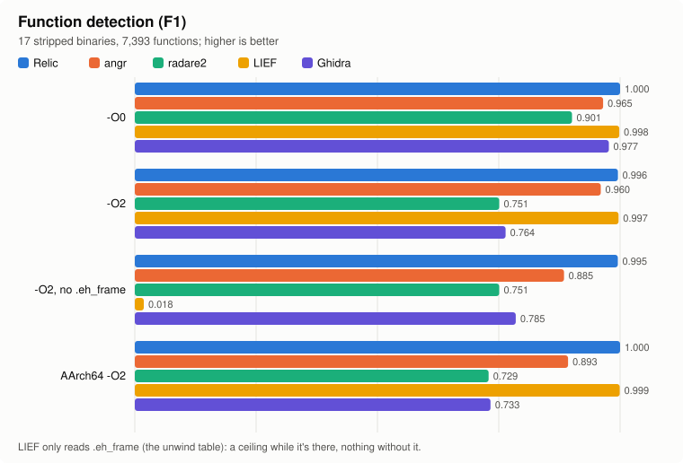
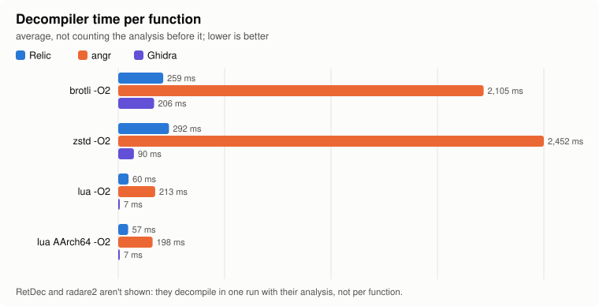

# Benchmarks against other open-source tools

How Relic compares with **Ghidra**, **angr**, **RetDec**, **radare2** and **LIEF** on
stripped Linux binaries: how many functions each finds and how many of those are real (function
detection), how well its file loader agrees with LIEF's, and how its decompiler's output
compares with Ghidra's, angr's, RetDec's and radare2's. Measured 2026-11-17/18 on a 4-core
x86-64 Linux container. Each timing is a single run.

| Tool | Version | What it was compared on |
|---|---|---|
| Relic | 1.5.0 + this branch | everything |
| Ghidra | 12.2 | function detection (headless auto-analysis), decompiler |
| angr | 10.0.7 | function detection (`CFGFast`), decompiler |
| RetDec | 5.0 | decompiler |
| radare2 | 5.5.0 | function detection (`aaa`), its pseudocode (`pdc`) |
| LIEF | 1.0.0 | function list from `.eh_frame`, file parsing |

Every tool runs with its default options. The scripts are in `tools/`, so anyone can rerun
everything, and `tools/bench_charts.py` redraws the charts from their JSON output.

## Corpus

Built from source with gcc 13.3 (`-fno-stack-protector`), then `strip`ped. The unstripped copy
supplies the ground truth: its function symbols (`readelf -s`, so none of the compared tools)
inside `.text`. Every tool sees only the stripped copy.

| Program | Source |
|---|---|
| brotli | brotli 1.2.1, the `brotli` command line tool |
| lua | Lua 5.4 interpreter (`lua.c` and the library) |
| zstd | zstd 1.5.7 single-file library plus a small driver |
| vuln, flow | Relic's own test programs (`tests/src`) |

Each in four builds: `-O0`, `-O2`, `-O2` without `.eh_frame` (`-fno-asynchronous-unwind-tables`;
some toolchains and most hand-written or obfuscated code have no unwind tables), and `-O2` for
AArch64 (lua and zstd only). 17 binaries, 7,393 functions.

## Function detection

`python tools/compare_tools.py CORPUS --angr-python PY_WITH_ANGR_AND_LIEF --tools relic,angr,r2,lief,ghidra --ghidra GHIDRA_DIR --json out.json`

Recall: share of the true functions a tool finds. Precision: share of what it reports that is a
true function start. Only addresses in `.text` are scored (PLT stubs aren't functions of the
program). Totals over all binaries of a build; time is the whole analysis, summed.

| Build (functions) | Tool | Recall | Precision | F1 | Time |
|---|---|---:|---:|---:|---:|
| -O0 (2,877) | **Relic** | **1.000** | 0.972 | **0.986** | 9.4 s |
| | angr | 0.998 | 0.934 | 0.965 | 44.9 s |
| | Ghidra | 0.955 | 1.000 | 0.977 | 257.2 s |
| | radare2 | 0.820 | 1.000 | 0.901 | 19.0 s |
| | LIEF (eh_frame) | 0.997 | 1.000 | 0.998 | 1.7 s |
| -O2 (1,610) | **Relic** | 0.986 | 0.945 | **0.965** | 16.3 s |
| | angr | 0.991 | 0.932 | 0.960 | 48.2 s |
| | Ghidra | 0.620 | 0.996 | 0.764 | 114.0 s |
| | radare2 | 0.601 | 1.000 | 0.751 | 9.6 s |
| | LIEF (eh_frame) | 0.994 | 1.000 | 0.997 | 1.7 s |
| -O2, no .eh_frame (1,610) | **Relic** | **0.983** | **0.945** | **0.963** | 18.3 s |
| | angr | 0.961 | 0.819 | 0.885 | 49.6 s |
| | Ghidra | 0.653 | 0.984 | 0.785 | 115.4 s |
| | radare2 | 0.601 | 1.000 | 0.751 | 9.2 s |
| | LIEF (eh_frame) | 0.009 | 1.000 | 0.018 | 1.8 s |
| AArch64 -O2 (1,296) | **Relic** | **1.000** | **0.940** | **0.969** | 11.3 s |
| | angr | 0.999 | 0.807 | 0.893 | 18.9 s |
| | Ghidra | 0.665 | 0.816 | 0.733 | 42.9 s |
| | radare2 | 0.576 | 0.992 | 0.729 | 4.8 s |
| | LIEF (eh_frame) | 0.998 | 1.000 | 0.999 | 1.7 s |

- **Relic has the best F1 of the code analysers in every build**, and is 3–5× faster than angr
  (1.7–4.8× on AArch64) and 4–27× faster than Ghidra.
- **Ghidra** is close to perfect at -O0 but, with its default analysis, misses a third of the
  functions at -O2 (recall 0.62): functions reached only through pointers (`main`, handed to
  `__libc_start_main`, callbacks, function tables) or tail calls. It almost never reports a wrong
  one on x86-64; on AArch64 18% of what it reports isn't a function start. Its times include
  about 9 s of Java start-up per binary.
- **Without `.eh_frame`** Relic barely changes (F1 0.965 → 0.963), angr drops to 0.885 and
  LIEF to nearly nothing: LIEF's list *is* the unwind table, which is why it is close to
  perfect when that's there. It's a ceiling to compare with, not a code analyser.
- **radare2** reports nothing false but misses 18% of the functions at -O0 and 40% at -O2
  (functions only reached through pointers or tail calls).

Where Relic's remaining false positives come from (what to fix next):

- **lua**: the label table of `luaV_execute`'s computed `goto`s is read as a table of function
  pointers (lua-O2: precision 0.89).
- **`.cold` parts**: gcc moves the unlikely parts of a function into `foo.cold`; they have a
  symbol of their own, so they count as functions in the ground truth, but Relic (rightly)
  treats them as parts of their parent, which costs recall.
- **zstd -O2**: one function's end is placed too late, past about ten small functions that follow
  it, and that binary takes 13.6 s against 1.5 s for brotli of the same size.

## File parsing (Relic's loader vs LIEF)

`python tools/compare_formats.py FILE... --lief-python PY --json out.json`

221 files: 150 programs from `/usr/bin`, 60 libraries from `/usr/lib/x86_64-linux-gnu` and
Relic's test binaries (ELF, PE, Mach-O, object files, several architectures).

| | Relic | LIEF |
|---|---:|---:|
| Files parsed | 221 / 221 | 221 / 221 |
| Same entry point | 219 | |
| Same sections (name and address) | 219 | |
| ELF imports, precision vs `readelf --dyn-syms` | 0.710 | 1.000 |
| ELF imports, recall | 0.958 | 0.969 |
| Total parsing time | 37.3 s | 1.1 s |

- The two section disagreements are Mach-O object files, where Relic also lists the sections it
  makes up for external symbols and the GOT (`__extern`, `__got`).
- **Imports.** The difference is mostly a matter of definition: Relic lists as imports the
  variables a program takes from a library through copy relocations (`stderr`, `stdout`),
  which `readelf` shows as defined in the program (that's the precision gap). It misses
  imported *data* symbols that nothing relocates through the PLT, such as C++ type-info
  vtables (`_ZTVN10__cxxabiv117__class_type_infoE`) and `__progname`. LIEF misses weak symbols
  (`__gmon_start__`, `_ITM_*`).
- **Speed.** LIEF is C++; Relic's loader is pure Python and does more on load (symbols,
  relocations, demangling): about 34× slower, 0.17 s per file on average.

## Decompiler (Relic vs Ghidra, angr, RetDec and radare2)

`python tools/compare_decompilers.py CORPUS NAME... --tools relic,angr,ghidra,retdec,r2 --angr-python PY --ghidra DIR --retdec PROGRAM --limit 300 --json out.json`

The true functions of each stripped binary (up to 300 per binary, 1,233 in all), given to every
tool by address: Ghidra and RetDec decompile them even where their own analysis didn't make a
function there. "Valid C": the pseudocode of one function, alone, passes `gcc -fsyntax-only`
after a prelude of the types the tool's own output uses (the `<stdint.h>` types for all of them,
Ghidra's `undefined8`, `byte`, `processEntry` ..., the headers RetDec's output includes); errors
about what the function uses without declaring it (globals, callees, struct types) are not
counted, only output that isn't C. Time: per function, not counting the analysis before it
(Relic, Ghidra, angr); RetDec decompiles the whole list in one run, analysis included.

| Binary | Functions | Tool | Decompiled | Valid C | gotos | Lines | Time |
|---|---:|---|---:|---:|---:|---:|---:|
| brotli -O2 | 249 | Relic | 247 | **205** | 3,356 | 100,467 | 62 s |
| | | Ghidra | 249 | 172 | 5,593 | 84,783 | 51 s |
| | | angr | 246 | 121 | 1,893 | 77,078 | 518 s |
| | | RetDec | 249 | 203 | 5,234 | 109,316 | 158 s (all) |
| zstd -O2 | 300 | Relic | 290 | **275** | 3,793 | 130,742 | 85 s |
| | | Ghidra | 300 | 207 | 3,951 | 89,731 | 27 s |
| | | angr | 296 | 122 | 2,368 | 101,357 | 726 s |
| | | RetDec | 298 | 249 | 7,376 | 136,629 | 203 s (all) |
| lua -O2 | 300 | Relic | 294 | **293** | **47** | 15,643 | 17 s |
| | | Ghidra | 300 | 291 | 179 | 9,708 | 2.1 s |
| | | angr | 294 | 263 | 131 | 13,538 | 63 s |
| | | RetDec | 295 | 291 | 361 | 9,242 | 6.2 s (all) |
| lua AArch64 -O2 | 300 | Relic | 300 | **297** | **46** | 16,211 | 17 s |
| | | Ghidra | 300 | 285 | 176 | 9,806 | 2.2 s |
| | | angr | 299 | 273 | 131 | 15,336 | 59 s |
| | | RetDec | 288 | 275 | 410 | 9,945 | 4.9 s (all) |
| vuln, flow (-O0, -O2) | 84 | Relic | 84 | 83 | 3 | 1,346 | 0.8 s |
| | | Ghidra | 84 | **84** | 1 | 1,462 | 0.5 s |
| | | angr | 80 | 80 | 1 | 1,239 | 7.6 s |
| | | RetDec | 84 | 83 | 3 | 1,280 | 0.6 s (all) |

radare2 decompiled all of them, 0 valid C (below).

- **radare2's `pdc`** decompiled every function but prints annotated pseudo-assembly
  (`rsp -= 0x18`, `goto loc_0x1460`), never C: 0 valid. It isn't timed per function here (one run
  for all of them, analysis included).
- **Valid C, in short:** Relic has the most valid functions on every one of the four programs:
  92% on zstd (RetDec 83%, Ghidra 69%, angr 41%), 82% on brotli (level with RetDec), 98–99% on
  lua (Ghidra and RetDec 92–97%). What's left in brotli and zstd is mostly `goto`-heavy state
  machines where a value is used both as a pointer and as an integer.
- **Speed:** Ghidra's decompiler is the fastest per function (7 ms on lua, 90–206 ms on the big
  functions of zstd and brotli), Relic second (56–292 ms), angr 3.5–8.5× slower than Relic.
  Counted with its analysis, Ghidra takes longer overall (Java start-up and its full
  auto-analysis: 20–55 s per binary, against 1–14 s for Relic's).
- **gotos:** Relic has the fewest on lua (47 against 131–410) and fewer than Ghidra and RetDec on
  brotli and zstd, but more than angr there (3,356 against 1,893 on brotli).
- **Relic before this benchmark:** it found several places where Relic printed something gcc
  rejects; they are fixed on this branch (the table above shows the fixed version). Valid
  functions:

  | | brotli | lua | zstd | lua AArch64 |
  |---|---:|---:|---:|---:|
  | Relic before | 114 | 249 | 122 | 264 |
  | Relic now | 205 | 293 | 275 | 297 |

  What was fixed: arithmetic on pointers that C doesn't allow (`p1 * 8`, `p1 & 7`,
  `p1 + p2`) now casts the pointers to `int64_t`; an offset added to a `char *` prints as a
  number, never as a string literal at that address; a call through a local variable that
  isn't typed as a function pointer gets a cast; a struct whose only field is an array no
  longer declares a flexible array member alone (`[0]`, gcc's extension), and an array of
  unknown length followed by other fields gets the length up to the next one; a struct pointer
  read from an integer array is cast before `->` (`((struct s_18 *)a1[3])->f_18`, which Lua's
  `lua_State` accesses are full of).
  The big -O2 functions (inlined state machines, unrolled hash loops) are where every
  structurer falls back to `goto`.
- **Lines:** Relic's output is the longest on lua (about 1.6× Ghidra's), mostly because it keeps
  a temporary for each value read more than once.

## Caveats

- One run per measurement, in a shared container: treat timings as ±20%.
- angr runs with its defaults (`CFGFast()`, normalized for the decompiler); radare2 with `aaa`;
  Ghidra with its default auto-analysis (`analyzeHeadless -import`). More aggressive options
  (`aaaa`, angr's `force_complete_scan`, Ghidra's Aggressive Instruction Finder) trade time and
  precision for recall.
- Ghidra 12.2 came from the SourceForge mirror of its GitHub releases and RetDec 5.0 from the
  `remnux/retdec` Docker image (its official release archive), as GitHub downloads weren't
  reachable here.
- gzip, grep and SQLite were meant to be in the corpus but their builds (`./configure`) weren't
  run in this environment.
- Valid C says nothing about whether the pseudocode means the same as the binary; Relic's own
  tests check that by recompiling and running its output.
